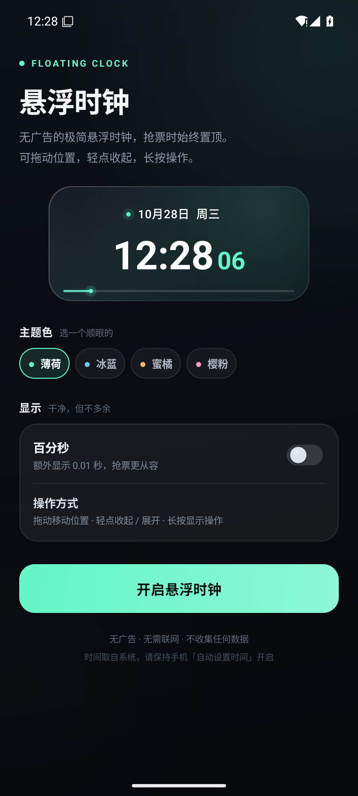
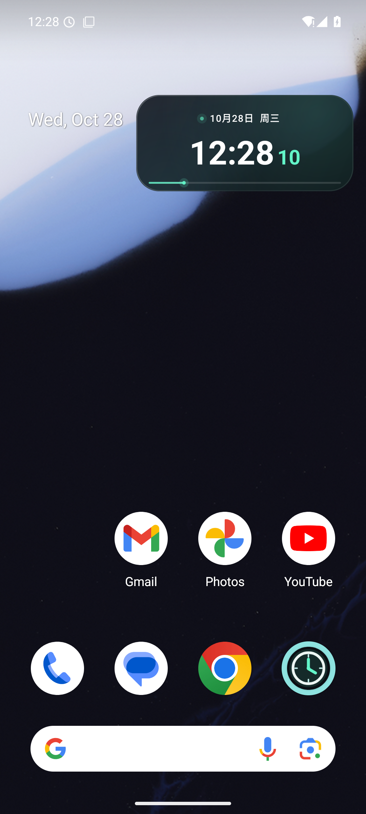
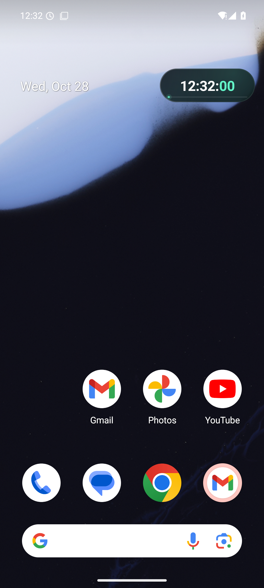

# 悬浮时钟 · Floating Clock

一个给自己用的极简 Android 悬浮时钟：**无广告、无需联网、没有第三方 SDK**。  
显示到秒，可选百分秒；四套配色，拖动自动贴边，轻点切换极简模式，长按出现「设置 / 关闭」。

**[⬇ 下载 APK（约 120 KB）](release/FloatingClock-v1.0.apk)** · Android 8.0+ · API 26–35

| 主界面 | 悬浮在桌面 | 极简模式 |
| --- | --- | --- |
|  |  |  |

> 实机截图来自 Android 15（API 35）模拟器，已完整验证安装、悬浮、收起、长按、拖动、通知栏停止。

---

## 一、直接安装

1. 下载 [`release/FloatingClock-v1.0.apk`](release/FloatingClock-v1.0.apk)，发送到手机。
2. 在手机上点击 APK，按系统提示允许「安装未知来源应用」。
3. 打开「悬浮时钟」，点击 **开启悬浮时钟**。
4. 按提示依次允许：
   - **显示在其他应用上层**（悬浮窗权限，必须）
   - **通知**（可选；拒绝也能用，只是通知栏看不到停止入口）
5. 返回桌面或打开购票 App，时钟就会浮在最上层。

> 部分国产 ROM（MIUI / HyperOS、ColorOS、OriginOS、EMUI 等）还需要在系统设置中额外允许
> 「后台弹出界面」「自启动」「悬浮窗」，并把本应用加入电池优化白名单，否则长时间悬浮可能被系统回收。

**APK SHA256**

```text
E1C4594C20EA572944ED148C96D782065B11D30BD869E3026D0DDAEECE996D82
```

---

## 二、怎么用

| 操作 | 效果 |
| --- | --- |
| 拖动 | 移动位置；松手自动贴到最近的一侧，位置会记住 |
| 轻点 | 在「完整模式 ↔ 极简模式」之间切换 |
| 长按 | 展开并显示「设置 / 关闭」操作条（4 秒后自动收起） |
| 极简模式长按 | 自动先展开，再显示操作条 |
| 通知栏「停止悬浮」 | 关闭悬浮窗 |
| 应用内「停止悬浮」 | 关闭悬浮窗 |

**完整模式**：日期、星期、时分秒、底部分钟进度条。  
**极简模式**：只保留 `时:分:秒` 的小胶囊，适合贴在购票按钮旁边，不挡视线。

### 百分秒

在首页打开「百分秒」后，完整模式会额外显示 `.00` 形式的百分秒。  
极简模式空间有限，只显示到秒；需要看百分秒时轻点展开即可。

### 抢票小贴士

- 本应用读取的是**手机系统时间**，不会联网校时。抢票前请确认手机已开启「自动设置时间」。
- 把悬浮钟拖到购票页「立即购买 / 提交订单」按钮附近，开启极简模式，倒计时到点直接点下面即可。
- 如果系统时间本身有偏差，建议先用运营商网络或系统自带对时功能校准。
- 悬浮窗是全局置顶的，也会显示在设置页、通知栏下拉等界面，这是正常现象。

---

## 三、隐私与权限

| 权限 | 用途 |
| --- | --- |
| `SYSTEM_ALERT_WINDOW` | 显示悬浮窗，唯一的核心权限 |
| `FOREGROUND_SERVICE` / `FOREGROUND_SERVICE_SPECIAL_USE` | 让时钟在后台持续显示，不被系统回收 |
| `POST_NOTIFICATIONS` | 显示前台服务通知（Android 13+） |

- **没有 `INTERNET` 权限**：应用无法联网，也不会上传任何数据。
- 没有广告 SDK、统计 SDK、账号体系。
- 设置只保存在本机 `SharedPreferences` 中。

---

## 四、从源码构建

### Android Studio

直接用 Android Studio 打开本目录（AGP 8.7.3 / JDK 17 / compileSdk 35），等待 Gradle 同步后
Run 或 Build APK。如果 IDE 提示缺少 Gradle wrapper，选择本机 Gradle 8.9 或让 IDE 生成 wrapper 即可；
也可以完全不用 Gradle，直接使用下面的命令行脚本。

### 命令行（不依赖 Gradle）

需要 JDK 17+ 与 Android SDK（`platforms;android-35`、`build-tools;35.0.0`）：

```powershell
$env:JAVA_HOME = "C:\Program Files\Java"
.\build-apk.ps1 -SdkRoot "D:\Android\Sdk" -JdkHome $env:JAVA_HOME
```

输出：`dist/FloatingClock-v1.0.apk` 和 `dist/SHA256.txt`。

首次构建会在 `signing/` 自动生成签名密钥（`floatingclock.keystore`）。
**请自己保留这个文件**，以后重新构建才能覆盖安装；它已加入 `.gitignore`，不会上传到仓库。
换电脑或丢失密钥后，需要先卸载旧版再装新版。

### 项目结构

```text
app/src/main/java/com/hejun/floatingclock/
  MainActivity.java    设置页：主题、百分秒、权限引导
  ClockService.java    前台服务 + 悬浮窗 + 拖动/贴边/手势
  ClockView.java       纯 Canvas 绘制的表盘、极光、进度条、动画
  ToggleSwitch.java    手绘开关，无第三方 UI 依赖
  BackdropView.java    设置页的呼吸渐变背景
  Prefs.java           本地设置
app/src/main/res/       图标、名称、主题
build-apk.ps1           aapt2 + javac + d8 + apksigner 构建脚本
release/                已签名 APK
docs/screenshots/       README 截图
```

实现上刻意避免了 AndroidX / Material / Kotlin 依赖，整包只有约 120 KB；
悬浮窗约 30 fps 绘制，息屏时会自动停止重绘以省电。

---

## 五、常见问题

**Q：点击开启后没有反应？**  
A：确认「显示在其他应用上层」已允许；部分 ROM 的开关在「设置 → 应用管理 → 悬浮时钟 → 其他权限」里。

**Q：杀后台后时钟消失？**  
A：把本应用加入电池优化白名单 / 允许自启动。这是国产 ROM 的后台限制，不是应用崩溃。

**Q：时间比标准时间快/慢？**  
A：应用只读系统时间；请打开手机「自动设置时间」，或手动校准系统时间。

**Q：为什么通知栏有一条常驻通知？**  
A：Android 要求后台悬浮窗必须以前台服务运行；通知是系统强制显示，不是广告。点通知可回到设置，通知里的「停止悬浮」可直接关闭。

---

## 版本

**v1.0** — 首个版本：悬浮显示、百分秒、四主题、拖动贴边、极简模式、长按操作、通知栏停止。
